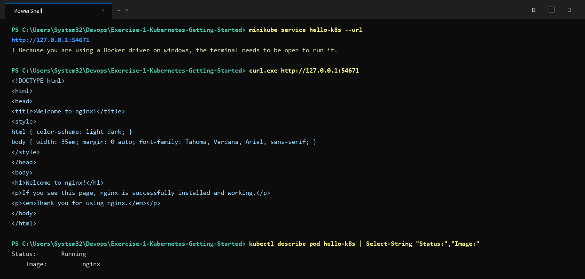

# Exercise 1: Kubernetes Getting Started (Hello Pod)

## Objective
Run your first containerized application inside Kubernetes and access it via a service.

## Business Context
Simulating the deployment of a lightweight storefront / web app (using Nginx) on Kubernetes to ensure high availability, portability, and readiness for future scaling.

## Architecture & Components
- **Pod**: `hello-k8s` running official `nginx` image on port 80.
- **Service**: `hello-k8s` exposing the Pod on port 80 using `NodePort`.

## Manifests
- `pod.yaml`: Kubernetes Pod definition.
- `service.yaml`: Kubernetes Service definition exposing the Pod.

## How to Run

### Option 1: Using Manifests
```bash
kubectl apply -f pod.yaml
kubectl apply -f service.yaml
```

### Option 2: Using the Deployment Script
- On Linux/macOS/WSL:
  ```bash
  chmod +x deploy.sh
  ./deploy.sh
  ```
- On Windows PowerShell:
  ```powershell
  .\deploy.ps1
  ```

### Verify Status
```bash
kubectl get pods
kubectl get services
```

### Accessing the Service
To obtain the service URL and open it in Minikube:
```bash
minikube service hello-k8s --url
```
Or test via curl:
```bash
curl $(minikube service hello-k8s --url)
```

## Execution Proof & Screenshots

### 1. Pod and Service Deployment


### 2. Service Access & Nginx Verification


