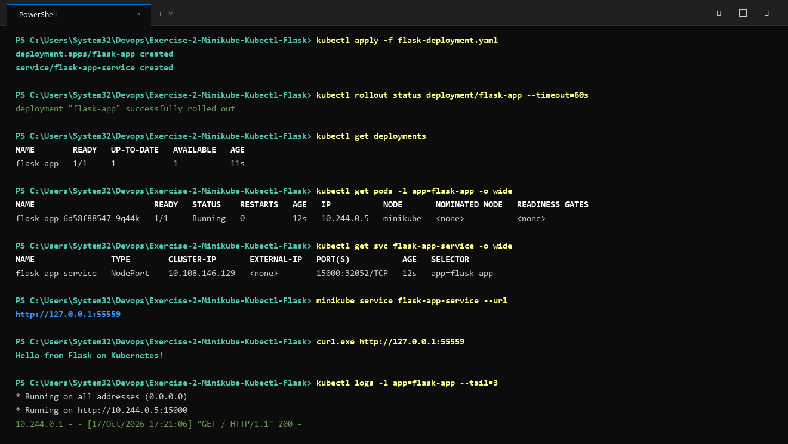

# Exercise 2: Deploy a Flask App on Minikube using kubectl and YAML

## Objective
Set up a single-node Minikube cluster and deploy a custom Python Flask web application containerized with Docker, managing deployment and access via Kubernetes YAML manifests.

## Key Concepts
- **`imagePullPolicy: Never`**: Ensures Kubernetes uses the local Docker image built into Minikube without attempting to pull from Docker Hub.
- **NodePort Service**: Maps external port (Service port 15000) to internal targetPort 15000 in the container.

## Architecture
- **Flask App**: Running on port 15000 returning `"Hello from Flask on Kubernetes!"`.
- **Deployment**: `flask-app` managing 1 replica pod.
- **Service**: `flask-app-service` exposes port 15000 with NodePort.

## How to Build and Deploy

### 1. Build Docker Image inside Minikube
```bash
# Point local Docker CLI to Minikube's Docker daemon
eval $(minikube docker-env)

# Build image
docker build -t flask-app:latest .
```
*(On Windows PowerShell, use: `minikube image build -t flask-app:latest .` or load image via `minikube image load flask-app:latest`)*

### 2. Apply Manifests
```bash
kubectl apply -f flask-deployment.yaml
```

### 3. Verify
```bash
kubectl get deployments
kubectl get pods -l app=flask-app
kubectl get services
```

### 4. Access the Service
```bash
minikube service flask-app-service --url
```
Test with curl:
```bash
curl $(minikube service flask-app-service --url)
```

## Execution Proof & Screenshots

### 1. Docker Build and Minikube Image Load


### 2. Kubernetes Deployment, Rollout & Service Verification


