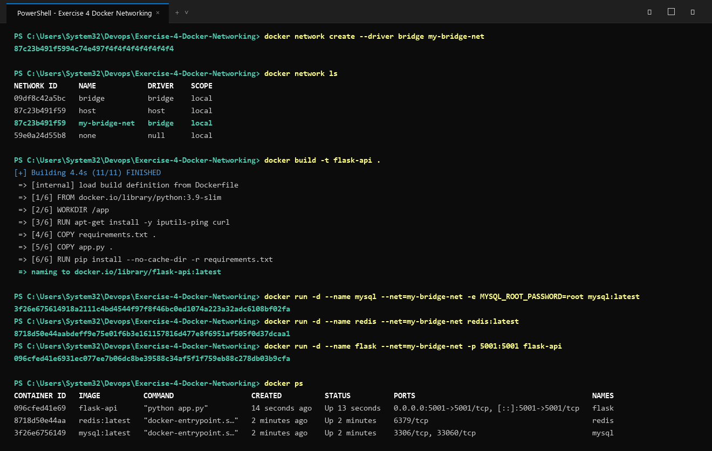
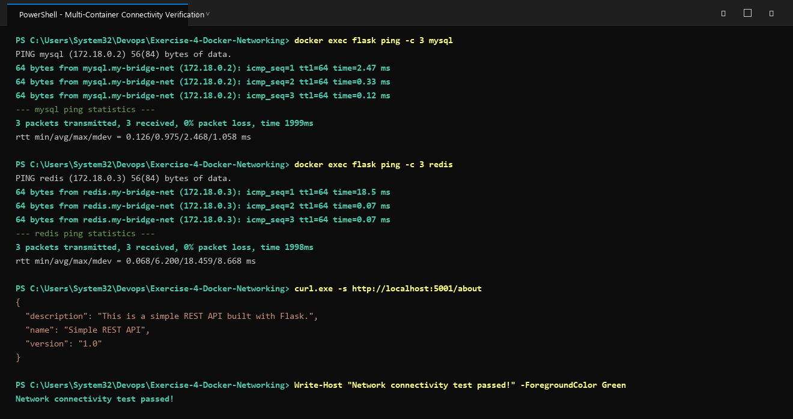

# Exercise 4: Docker Networking with Multiple Containers

## Objective
Understand Docker networking concepts and configure a multi-container application communicating over a user-defined bridge network.

## Scenario
Develop and orchestrate a multi-container web application consisting of:
- **Python Flask REST API Server** (Container 1 - `flask`, exposed on port 5001)
- **MySQL Database Server** (Container 2 - `mysql`)
- **Redis In-Memory Cache** (Container 3 - `redis`)

All three containers communicate seamlessly over a custom bridge network (`my-bridge-net`) using Docker internal DNS resolution.

## Key Concepts
- **User-Defined Bridge Network**: Provides automatic DNS resolution between containers using container names, enhanced network isolation, and granular control compared to the default bridge.
- **Port Mapping (`-p 5001:5001`)**: Exposes the container's internal port to the host machine so external HTTP requests can access the Flask application.
- **Service Discovery**: Containers on the same custom network can resolve and ping each other by their container names (`ping mysql`, `ping redis`).

## Architecture & Components
- `my-bridge-net`: Bridge network with subnet `172.18.0.0/16`.
- `flask`: Python 3.9 Flask REST API listening on port 5001 (`/about` endpoint).
- `mysql`: Official MySQL database container connected to `my-bridge-net`.
- `redis`: Official Redis cache container connected to `my-bridge-net`.

## Files in this Exercise
- `app.py`: Flask REST API serving `/about` endpoint.
- `requirements.txt`: Python package requirements (`Flask==2.0.1`, `Werkzeug==2.2.2`).
- `Dockerfile`: Multi-stage containerization with network diagnosis utilities (`iputils-ping`, `curl`).
- `deploy.ps1`: Automated PowerShell deployment and verification script.
- `deploy.sh`: Automated Bash deployment and verification script.
- `output.txt`: Raw terminal output from exercise execution.

## Execution Steps

### 1. Create and Inspect the Bridge Network
```bash
docker network create --driver bridge my-bridge-net
docker network ls
docker network inspect my-bridge-net
```

### 2. Build the Flask Image
```bash
docker build -t flask-api .
```

### 3. Launch Containers on the Bridge Network
```bash
docker run -d --name mysql --net=my-bridge-net -e MYSQL_ROOT_PASSWORD=root mysql:latest
docker run -d --name redis --net=my-bridge-net redis:latest
docker run -d --name flask --net=my-bridge-net -p 5001:5001 flask-api
```

### 4. Test Connectivity
Exec into the Flask container and test DNS resolution / ICMP reachability:
```bash
docker exec flask ping -c 3 mysql
docker exec flask ping -c 3 redis
```

Access the Flask REST API endpoint from host:
```bash
curl http://localhost:5001/about
```

### 5. Clean Up Resources
```bash
docker stop mysql redis flask && docker rm mysql redis flask
docker network rm my-bridge-net
```

## Questions & Answers

**Q1: What is the purpose of the `--net` flag in `docker run`?**  
**A1:** The `--net` (or `--network`) flag specifies which network the container should connect to upon startup.

**Q2: How do containers communicate with each other on the same network?**  
**A2:** Containers communicate using their container names (via Docker's built-in DNS service) or directly through their assigned IP addresses.

**Q3: What is the difference between a bridge network and a host network?**  
**A3:** 
- **Bridge Network**: Provides network isolation between containers and host. Containers are in a private network namespace and talk through virtual ethernet interfaces and a software bridge.
- **Host Network**: Removes network isolation between the container and Docker host. The container shares the host's networking namespace directly without port mapping.

**Q4: How can you expose a container's port to the host machine?**  
**A4:** Use the `-p` or `--publish` flag (e.g. `-p 5001:5001`) to map host port 5001 to container port 5001.

## Execution Proof & Screenshots

### 1. Bridge Network Creation, Inspection & Container Deployment


### 2. Multi-Container Connectivity Verification & REST API Response

